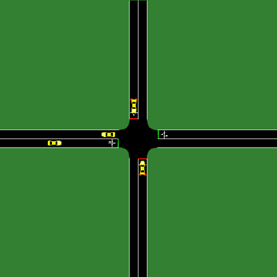
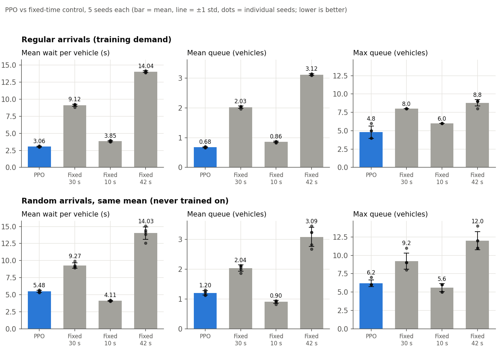
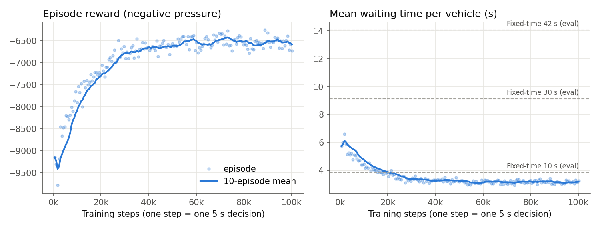

# Smart traffic signal control with deep RL (PPO + SUMO)

A PPO agent that decides when to switch a simulated 4-way traffic signal, compared against fixed-time signal plans on the same simulator, seeds and metrics.

**Live demo:** [vedantkinikar.duckdns.org/projects/smart-traffic-drl/demo/](https://vedantkinikar.duckdns.org/projects/smart-traffic-drl/demo/) replays recorded SUMO runs of PPO and the 10 s fixed-time plan, on both demand patterns and seeds 1 to 5, with live counters. It is a replay of simulated runs, not a model running in the browser; every run's final numbers match `results/eval_episodes.csv`.



*90 s of simulation shown at 5x speed, with PPO in control (seed 1, regular demand). The red and green bars at the stop lines are the signals.*

**In short:** on the traffic pattern it was trained on, PPO cut mean waiting time to **3.06 s** per vehicle, compared with **9.12 s** for a 30 s fixed-time plan and 3.85 s for the best fixed plan tested (10 s greens). On random arrivals it never saw in training, PPO (5.48 s) still beat the 30 s plan (9.27 s) but lost to the 10 s fixed plan (4.11 s). Details and caveats below.

## Problem

A fixed-time signal gives each direction the same green time whatever the traffic is doing. A controller that can see the queues should be able to do better. The questions here are whether a reinforcement learning agent learns a better switching policy, and whether that still holds against a well-chosen fixed plan rather than a weak one.

## Approach

**Simulation.** SUMO 1.25 runs one signalised 4-way junction (`sumo_scenario/simple.*`). Each approach is a single 243 m lane, and all traffic goes straight through. Demand is 200 vehicles/hour from each of the four approaches for one hour (800 vehicles in total). In the training scenario SUMO inserts vehicles at even 18 s intervals.

**Agent.** PPO from Stable-Baselines3, with the default two-layer (64, 64) MLP.

- **State (10 numbers):** vehicles on each approach lane, total waiting time on each approach lane, which direction has green now, and how long it has had it. Each value is scaled to roughly 0 to 1.
- **Action:** every 5 s the agent picks which direction gets green, north-south or east-west. If it picks the other direction, the environment runs the 3 s yellow first and then switches. A switch is refused until the current green has run for at least 10 s.
- **Reward:** each second, minus the junction's "pressure": for each approach, vehicles on the incoming lane minus the average on its outgoing lanes (floored at zero), summed over the four approaches. Each switch costs a further 1 point. Low pressure means few vehicles are being held at the junction.

**Baselines.** Fixed-time plans run through the same environment code as PPO, so they get the same yellow handling and metrics:

| Plan | Green per direction | Yellow | Cycle |
|---|---|---|---|
| Fixed-time 30 s (main baseline) | 30 s | 3 s | 66 s |
| Fixed-time 10 s (shortest green the env allows; short cycles suit light demand) | 10 s | 3 s | 26 s |
| Fixed-time 42 s (the plan SUMO's netconvert generated for this network) | 42 s | 3 s | 90 s |

**Evaluation.** Each controller runs one simulated hour on seeds 1 to 5. Training used different seeds: seed 0 for the first episode, then random draws from 1000 upwards. For a given seed every controller sees exactly the same vehicles. The metrics are:

- **Mean waiting time per vehicle (s):** total seconds that vehicles spent stopped (speed below 0.1 m/s) on the four approaches, divided by the number of vehicles that entered the network.
- **Mean queue (vehicles):** stopped vehicles across the four approaches, averaged over every second of the hour.
- **Max queue (vehicles):** the highest that total reached during the hour.
- **Throughput (vehicles):** vehicles that finished their trip within the hour.

Each episode stops at 3,600 s. SUMO teleporting is turned off, so every stopped second is counted.

## Results

Each cell shows the mean ± standard deviation over 5 seeds. "Switches" is the number of green changes in the hour. Per-seed results are in [`results/eval_episodes.csv`](results/eval_episodes.csv) and the summary is in [`results/eval_summary.csv`](results/eval_summary.csv).

**Regular arrivals (the demand PPO was trained on), seeds 1 to 5**

| Controller | Mean wait per vehicle (s) | Mean queue (veh) | Max queue (veh) | Throughput (veh) | Switches |
|---|---|---|---|---|---|
| **PPO** | **3.06 ± 0.07** | 0.68 ± 0.02 | 4.8 ± 0.8 | 792.0 ± 0.0 | 199 |
| Fixed-time 30 s | 9.12 ± 0.16 | 2.03 ± 0.04 | 8.0 ± 0.0 | 790.0 ± 0.0 | 109 |
| Fixed-time 10 s | 3.85 ± 0.10 | 0.86 ± 0.02 | 6.0 ± 0.0 | 792.2 ± 0.4 | 277 |
| Fixed-time 42 s | 14.04 ± 0.12 | 3.12 ± 0.03 | 8.8 ± 0.4 | 788.8 ± 0.4 | 75 |

**Random arrivals with the same average rate (never seen in training), seeds 1 to 5**

| Controller | Mean wait per vehicle (s) | Mean queue (veh) | Max queue (veh) | Throughput (veh) | Switches |
|---|---|---|---|---|---|
| **PPO** | **5.48 ± 0.16** | 1.20 ± 0.08 | 6.2 ± 0.4 | 779.2 ± 39.8 | 177 |
| Fixed-time 30 s | 9.27 ± 0.39 | 2.04 ± 0.11 | 9.2 ± 1.1 | 779.0 ± 39.7 | 109 |
| Fixed-time 10 s | 4.11 ± 0.07 | 0.90 ± 0.05 | 5.6 ± 0.5 | 780.6 ± 38.9 | 277 |
| Fixed-time 42 s | 14.03 ± 0.92 | 3.09 ± 0.32 | 12.0 ± 1.2 | 776.0 ± 40.3 | 75 |



**What the numbers say**

- On the training demand, PPO had the lowest mean waiting time and mean queue of all four controllers on every seed.
- However, PPO switched exactly 199 times on every seed, about once every 18 s. That matches the 18 s gap between vehicles on each approach. With evenly spaced arrivals the agent has largely learned the rhythm of this particular demand. Under regular demand the seed only changes driver behaviour (SUMO's `sigma`), not when vehicles arrive, which is why the spread is small.
- With random arrivals at the same average rate (`sumo_scenario/random.*`), PPO does react: its switch count varied between seeds. It still clearly beat the 30 s and 42 s plans, but the simple 10 s fixed plan beat it on waiting time and queues. The advantage over a well-chosen fixed plan did not carry over to a traffic pattern it hadn't trained on.
- Throughput is effectively the same for every controller. At this light demand all of them clear the traffic, and the small differences are vehicles still on the road at the one-hour mark. Under random demand the throughput spread comes from the number of vehicles generated, which ranged from 735 to 825 across seeds, not from the controllers.

### Training



PPO trained for 100,352 steps (169 one-hour episodes, one step = one 5 s decision) in about 15 minutes on a laptop CPU. Hyperparameters: learning rate 3e-4, `n_steps` 2048, batch 64, 10 epochs, gamma 0.99, GAE lambda 0.95, clip 0.2, entropy coefficient 0.001, seed 0. Rewards were normalised during training only (`VecNormalize`). Mean waiting time per training episode fell from 5.49 s over the first 10 episodes to 3.29 s by 40k to 50k steps, and was 3.20 s over the last 10. Most of the learning happened in the first 50k steps. Raw per-episode data is in [`results/ppo_v2_logs/monitor.csv`](results/ppo_v2_logs/monitor.csv).

## Limitations

- **One simulated junction:** single-lane approaches, straight-through traffic only, no turning movements, pedestrians or neighbouring signals.
- **Synthetic, constant, light demand:** 200 vehicles/hour per approach for one hour, with no peaks. The agent was trained only on evenly spaced arrivals, and the results above show it partly learned that pattern instead of general queue-responsive control.
- **Limited baselines:** the comparison is against fixed-time plans only. Vehicle-actuated control and max-pressure control are the stronger, more realistic benchmarks for an adaptive controller, and they are not included.
- **Small sample:** one training run (one training seed) and 5 evaluation seeds, so variation between training runs is not measured.
- **Sim-to-real gap:** the agent sees exact vehicle counts and waiting times along 243 m of road. Real detectors such as loops and cameras are noisier and see less. SUMO's driver model is a simplification, and real signals carry safety rules (pedestrian phases, all-red clearance, maximum greens) that this environment leaves out.
- **Proxy reward:** the reward is pressure, not waiting time directly. The two line up here, but that is not guaranteed in other layouts.

The obvious next steps are to train on random and time-varying demand, add an actuated or max-pressure baseline, and repeat training over several seeds.

## How to run

Requires Windows 10/11 (other platforms should work but are untested), Python 3.11+ (tested on 3.14) and [SUMO](https://eclipse.dev/sumo/) 1.25 with `SUMO_HOME` set to the SUMO install folder (for example `C:\Program Files (x86)\Eclipse\Sumo`) and its `bin` folder on `PATH`.

```powershell
python -m venv venv
.\venv\Scripts\Activate.ps1
pip install -r requirements.txt

python test_sumo.py               # smoke test: SUMO starts and the signal phases sequence correctly
python -m agents.train            # train PPO (~15 min on CPU) -> results/ppo_traffic_v2.zip
python -m agents.eval             # PPO vs fixed-time, 5 seeds, both demand patterns -> results/eval_*.csv
python notebooks/plot_results.py  # figures -> results/figures/
python -m agents.eval --gif       # optional: record the GIF above (opens sumo-gui)
python demo/record.py             # optional: re-record the browser replay's runs -> demo/runs/, checked against results/eval_*.csv
```

Run every command from the repo root. Training logs go to `results/ppo_v2_logs/`, and `tensorboard --logdir results/ppo_v2_logs` shows the training curves. The trained model `results/ppo_traffic_v2.zip` is included, so you can skip training and go straight to evaluation.

### Project layout

```
envs/sumo_env.py          Gymnasium environment: state, actions, yellow/min-green logic, reward, metrics
baselines/fixed_time.py   fixed-time controller with the same predict() interface as the PPO model
agents/train.py           PPO training
agents/eval.py            evaluation of all controllers over the same seeds; GIF recording
notebooks/plot_results.py figures
sumo_scenario/            network, regular demand (simple.*) and random demand (random.*)
results/                  trained model, evaluation CSVs, training monitor log, figures
demo/                     browser replay (index.html) and the recorder that writes its runs (record.py)
```

### Note on the first version

In the first version of the environment, the action space was fixed at two actions before SUMO started. The agent was therefore choosing between north-south green and the yellow phase, and east-west only got green when SUMO auto-advanced past the yellow. Its evaluation and baseline scripts also measured different things. That version's model files (`results/ppo_traffic*.zip`) remain on the original machine but are not used or tracked, and none of the numbers above come from them.

## Tech stack

Python, SUMO 1.25 (TraCI), Gymnasium, Stable-Baselines3 (PPO), PyTorch, pandas, Matplotlib, Pillow.
